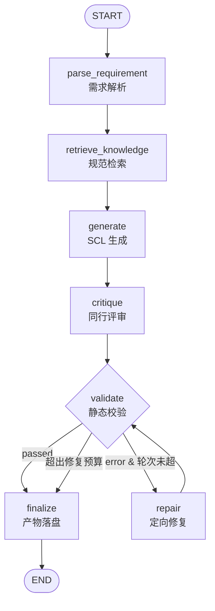

# PLC Agent：用 LangGraph 让大模型写西门子 PLC 控制代码

把「一句工艺需求」变成「可评审的 SCL 功能块 + IO 表 + 测试计划」的多智能体流水线。
核心不是 prompt，而是 **LLM 只负责生成，工程约束交给确定性校验器，错误回灌成修复闭环**。

```
需求(Markdown) ──▶ 解析 ──▶ 规范检索 ──▶ 代码生成 ──▶ 同行评审 ──▶ 静态校验 ──┬─▶ 落盘产物
                                                        ▲                    │
                                                        └── 定向修复 ◀── error ┘
```

## 能力

| 能力 | 实现 |
|---|---|
| 需求 → 结构化规格 | LLM 按 JSON schema 抽 IO 表、动作时序、安全要求 |
| 工程规范注入 | 本地BM25 规范库（SCL 结构 / 急停失效安全 / 状态机定时器 / IO 命名） |
| SCL 生成 | 单个 FUNCTION_BLOCK，S7-1500 优化块访问 |
| 代码评审 | 独立 Reviewer 角色，只挑问题不改代码 |
| 硬校验 | 14 条规则、纯 Python，不依赖 TIA 编译器 |
| 自修复 | 把 `[级 行 规则 说明]` 回灌，最多 N 轮，防死循环 |
| 产物 | `.scl`、`io_table.csv`、`validation_report.md`、`test_plan.md`、`run_summary.json` |

实测（离线 mock，同一份需求）：

| 场景 | 校验结果 | 修复轮次 |
|---|---|---|
| 正常生成 | 0 error / 0 warning | 0 |
| 注入 3 类典型 bug（漏 `END_IF;`、变量拼错、漏分号） | 首轮 2 error / 1 warning → 修复后 0 / 0 | 1 |

## 目录

```
plc_agent/
├── plc_agent/
│   ├── graph.py            # LangGraph 装配：7 节点 + 条件边
│   ├── nodes.py            # 各节点实现（唯一副作用是 finalize 落盘）
│   ├── state.py            # 共享 State 定义
│   ├── prompts.py          # 4 个角色的 prompt
│   ├── validator.py        # SCL 静态校验器（核心资产）
│   ├── rag.py              # BM25-lite 规范检索
│   ├── llm.py              # Mock / OpenAI 兼容 transport
│   ├── mock.py             # 离线后端 + 参考模板 + 注入 bug
│   ├── cli.py              # 命令行
│   ├── graphlib_compat.py  # 没装 langgraph 时的等价状态机
│   └── tools/openness.py   # TIA Openness 编译校验的接线说明
├── knowledge/              # 4 篇工程规范（RAG 语料）
├── examples/req_pump_station.md
├── tests/test_validator.py # 10 个用例，覆盖每条规则与整图链路
├── out/normal, out/repair  # 两次演示的产物
└── requirements.txt
```

## 快速开始

```bash
cd plc_agent
pip install -r requirements.txt

# 1) 离线跑通（不需要任何 API Key）
python -m plc_agent.cli -r examples/req_pump_station.md --backend mock --out out/normal

# 2) 演示"校验 → 修复"闭环：故意注入 3 类 bug
python -m plc_agent.cli -r examples/req_pump_station.md --backend mock --dirty --out out/repair

# 3) 换真模型（任意 OpenAI 兼容端点）
export PLC_AGENT_API_KEY=sk-xxx
export PLC_AGENT_BASE_URL=https://api.deepseek.com/v1
export PLC_AGENT_MODEL=deepseek-chat
python -m plc_agent.cli -r examples/req_pump_station.md --backend openai -o out/real

# 4) 跑测试
python -m pytest -q
```

> Mock 后端只会产出「泵站启停」参考模板，换工艺（输送线、阀门组、伺服定位）必须接真模型。

## 图结构



| 节点 | 角色 | 关键设计 |
|---|---|---|
| `parse_requirement` | Planner | 强制 JSON schema；解析失败回退启发式，图不中断 |
| `retrieve_knowledge` | Retriever | 用「工艺词 + 安全项」拼 query，避免整段需求噪声 |
| `generate` | Coder | 9 条硬约束（禁写 INPUT、定时器进静态区、地址带 `%`…） |
| `critique` | Reviewer | 只评审不改写，输出 `OK:` / `ISSUES:` 二值信号 |
| `validate` | Verifier | **不调用模型**，纯规则，可复现、可进 CI |
| `repair` | Repairer | 只做最小修改，禁止"删功能消除报错" |
| `finalize` | Packager | 落盘 5 个交付物 + 执行轨迹 |

## 校验规则（validator.py）

| 规则 | 级别 | 拦截的真实事故 |
|---|---|---|
| `E_NO_BLOCK` / `E_BLOCK_UNCLOSED` | error | 块头尾不配对，导入即失败 |
| `E_VAR_UNCLOSED` / `E_VAR_EXTRA` | error | `END_VAR` 漏写 |
| `E_STRUCT_UNBALANCED` | error | 嵌套 `IF` 漏 `END_IF`（LLM 最高频错误） |
| `E_SEMICOLON` | error | 语句/声明漏分号 |
| `E_UNDECLARED_WRITE` | error | 变量名拼错（`EStop` → `EStopp`） |
| `E_WRITE_INPUT` | error | 直接给 `VAR_INPUT` 赋值 |
| `E_INSTANCE_TEMP` | error | TON 实例声明在 `VAR_TEMP`，扫描结束即丢 |
| `E_IO_PREFIX` | error | 地址写成 `I0.0`（缺 `%`） |
| `W_TIMER_PULSE` | warning | 闪烁定时器 IN 恒为真，Q 每扫描周期翻转（灯变成高频闪） |
| `W_ESTOP_LOGIC` | warning | 急停未取反 —— 失效安全反了会停机变启动 |
| `W_OUTPUT_UNASSIGNED` | warning | 输出有分支没赋值，故障时保持上次值 |
| `W_UNDECLARED_READ` | warning | 可疑标识符（库调用会误报，故不设 error） |
| `W_LOGIC_IN_OB` | warning | 逻辑写进 OB，不可复用不可测 |
| `W_INSTANCE_UNDECLARED` | warning | 实例未声明背景数据 |

分级原则：**只有确定致命才报 error**。假阳性会让修复节点越修越坏。

## 接真模型

```bash
export PLC_AGENT_API_KEY=...          # 也认 OPENAI_API_KEY
export PLC_AGENT_BASE_URL=...         # 默认 https://api.openai.com/v1
export PLC_AGENT_MODEL=...            # 默认 gpt-4o-mini
```

代码里换 transport 只需实现 `BaseLLM.chat(system, user, role, payload)`。
Ollama / vLLM / 通义 / 豆包等只要是 `/v1/chat/completions` 协议都能直接接。

## 闭环接到真编译器（可选，强烈建议）

静态校验只能保证"结构与工程规范"，保证不了"TIA 能编译"。完整闭环：

```
SCL 生成 → 静态校验 → [Windows Runner: TIA Openness 导入并编译] → 编译错误回灌 repair
```

- `plc_agent/tools/openness.py` 写了接线方式与前置条件（Windows、TIA V16+、Openness 用户组、pythonnet）。
- 把 CompilerResult 的 `Messages` 拼成同样的 `[级 行 规则 说明]` 文本，直接复用 `repair` 节点即可。
- 无许可证时用 PLCSIM Advanced 做仿真验证，再上现场。

## 换成 CrewAI / AutoGen / 其他框架

图逻辑与框架无关：4 个 LLM 角色（Planner / Coder / Reviewer / Repairer）+ 1 个确定性校验器，
这是所有 agent 框架都能表达的公共结构。适配代码见 [`integrations/framework_adapters.md`](integrations/framework_adapters.md)。

要点：
- **校验器必须是普通函数**，不要包成 agent——agent 会"自由发挥"，校验不能。
- **状态显式传递**（spec / draft / issues），不要靠聊天历史隐式记忆，否则修 3 轮后模型会忘记原始需求。
- **修复预算写死在图里**（`max_repairs`），不写死在 prompt 里。

## 局限与红线

1. 产出是**工程初稿**，必须经过工艺 / 电气 / 安全三方评审 + PLCSIM 仿真 + 现场调试。
2. 涉及人身安全的联锁（急停、门锁、光幕）不得仅靠标准 CPU 的软件逻辑，需安全继电器或 F-CPU。
3. 单一 FB 的单文件生成；跨块（FB 调用 FB、UDT、多重背景）需要扩展 `spec` 与校验规则。
4. LAD/FBD 需要 TIA 侧转换或 Openness 生成 XML，本项目只覆盖 SCL。
